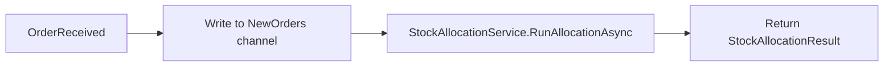
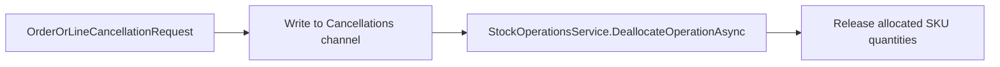

# WMS Stock Allocation Library

## Overview

This library implements the stock allocation and order cancellation logic for a Warehouse Management System (WMS). It is designed to be plugged into a larger WMS solution rather than run standalone.

## Assumptions and Decisions

- **Line item model**: one order line represents one product with a required quantity. That product is fulfilled from one or more `Sku` records, each of which has its own available quantity and warehouse location.
- **Scope**: this library currently implements **Task 1 (Stock Allocation)** and **Task 2 (Order / Line Cancellation)**. Task 3 (manual SKU quantity correction with substitute-SKU reconciliation) is not implemented.
- **Single project**: Task 1, Task 2 and Task 3 are tightly coupled - they all read and mutate the same order, SKU and allocation state - so they are kept together in one `Wms.Outbound` library rather than split into separate projects. This keeps the shared state (orders, SKUs, allocations) consistent and avoids synchronization issues between otherwise-independent modules.
- **Integration points**: to plug this library into the WMS, the host application must provide implementations for two repository interfaces:
  1. `IInventoryRepository` - reads and persists SKU data.
  2. `IOrderRepository` - supplies incoming orders and cancellation requests.
- **ERP integration**: it is assumed that order and cancellation events arrive from the ERP system through some message broker. Rather than depending on a specific broker, `IOrderRepository` exposes two events (`OrderReceived` and `OrderOrLineCancellationRequest`) that the host application raises when a message arrives. This keeps the library transport-agnostic.
- **Concurrency model**: allocation runs are serialized per process via a semaphore, and incoming orders/cancellations are processed through channels, so the same SKU or order is never mutated by two operations at once.

## Flow Diagrams

### Order allocation



### Order / line cancellation



## Running the tests

Test cases can be run either via the `dotnet test` command or through the Visual Studio Test Explorer.

```powershell
dotnet test
```
